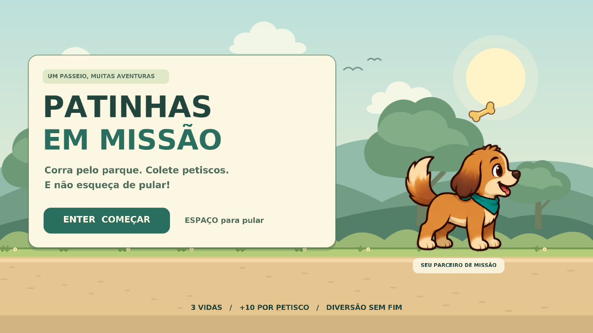
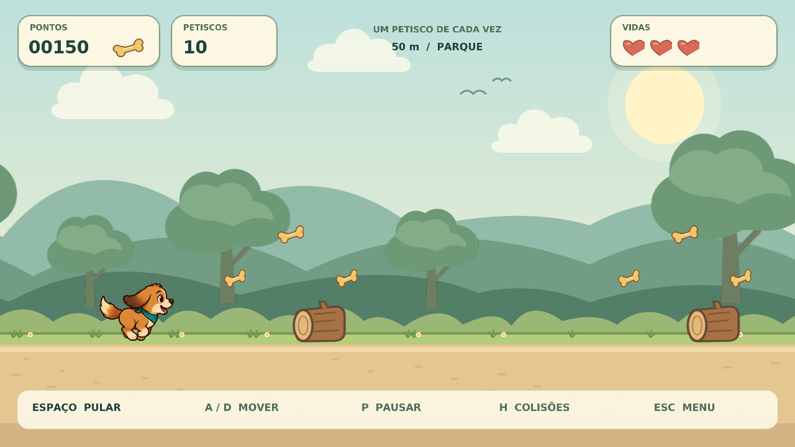

# 🐶 Patinhas em Missão

Protótipo de jogo 2D para **Processamento Gráfico: Fundamentos — Grau A**.
Um cachorro caramelo corre pelo parque, coleta petiscos e pula troncos, pedras e poças.
Desenvolvido em **C++ com OpenGL 3.3 Core**, shaders GLSL, GLFW, GLAD e GLM.

## ▶️ Jogar no Windows

1. **Extraia toda a pasta do ZIP**. Não execute de dentro do arquivo compactado.
2. Abra **JOGAR.bat**.
3. Pressione **Enter** para começar o jogo.

O pacote inclui `bin/Windows/PatinhasEmMissao.exe`, compilado para Windows 64 bits.
Para usar essa versão, não é necessário instalar compilador, Python ou bibliotecas de desenvolvimento.
Mantenha as pastas `assets`, `config` e `shaders` junto ao projeto.
O computador precisa de driver gráfico com suporte a OpenGL 3.3 ou superior.

## 🎮 Controles

| Tecla | Ação |
|---|---|
| Enter | Começar, jogar novamente ou retomar uma pausa |
| Espaço, W ou seta para cima | Pular quando estiver no chão |
| A / D ou setas esquerda / direita | Ajustar a posição horizontal |
| P | Pausar e continuar |
| R | Reiniciar a partida |
| H | Mostrar ou esconder as hitboxes de colisão |
| Esc | Voltar ao menu; no menu, fechar o jogo |

Ao alternar para outra janela, a partida pausa automaticamente.
Não é preciso apertar uma tecla para correr: o cenário avança sozinho.
O botão desenhado no menu indica o comando de teclado; esta versão não usa clique do mouse.

## 🍖 Regras

- A partida começa com 3 vidas. ❤️❤️❤️
- Cada petisco vale **10 pontos**; a distância percorrida também aumenta a pontuação. 🦴
- Colidir com um obstáculo retira uma vida. Após o impacto, o cachorro pisca e fica temporariamente protegido contra novos danos. 💥
- A velocidade aumenta gradualmente, tornando a partida mais difícil. ⚡
- Os obstáculos são separados por um intervalo que permite concluir o salto.
- O salto é controlado por velocidade vertical e gravidade. Um novo salto só ocorre quando o cachorro está no chão. ⬆️
- Ao perder todas as vidas, aparece a tela de fim de partida, com a opção de reiniciar. 🏁
- O recorde é mantido **durante a sessão** e é zerado ao fechar o programa.🏆

## 📂 Organização e Funcionamento do Código
O programa repete três etapas: receber comandos, atualizar as regras e desenhar a cena.

| Arquivo/pasta | Função |
|---|---|
| `src/main.cpp` | Janela, carregamento do OpenGL, teclado, tempo e game loop |
| `src/Game.hpp` | Dados do jogador, obstáculos, petiscos, configuração e estados |
| `src/Game.cpp` | Pulo, movimento, coleta, colisões, vidas, pontuação e reinício |
| `src/Renderer.hpp` e `src/Renderer.cpp` | Buffers, texturas, matrizes, sprites, camadas e interface |
| `shaders/sprite.vert` | Aplica `projection * model` e calcula o recorte da textura |
| `shaders/sprite.frag` | Amostra a textura, aplica cor/alfa e arredonda painéis |
| `config/game.cfg` | Parâmetros da partida e caminhos das imagens |
| `assets/dog.png` | Spritesheet do cachorro: 4 colunas × 2 linhas |
| `assets/items.png` | Petisco animado, tronco, pedra, poça e coração |
| `assets/sky.png`, `hills.png`, `trees.png`, `ground.png` | Camadas do parque |
| `assets/font.png` e `font.metrics` | Atlas de letras e avanços de texto |
| `assets/vector_sources` | SVGs originais dos recursos vetoriais |
| `tools/create_vector_assets.py` | Ferramenta opcional para regenerar cenário, itens e atlas da fonte |
| `tests/game_tests.cpp` | Testes das regras, sem dependência de OpenGL |
| `docs/ROTEIRO_APRESENTACAO.md` | Explicação dos conceitos e relação com o enunciado |
| `docs/CREDITOS.md` | Bibliotecas, referências e origem dos recursos visuais |

## ⚙️ Personalização

Edite `config/game.cfg` e reinicie o programa para alterar velocidade, vidas, gravidade, impulso do pulo,
quadros por segundo da animação, janela ou caminhos das imagens.
Os limites aceitos estão comentados no arquivo. Mantenha a altura do pulo suficiente para os obstáculos.
A verificação de configuração evita valores inválidos, mas mudanças de física e velocidade ainda exigem testar a jogabilidade.

Para trocar o personagem, preserve a disposição de 4 colunas × 2 linhas do atlas.
Os frames 0–3 mostram corrida; 4, parado; 5, subida; 6, descida; 7, pose feliz.
As hitboxes foram ajustadas para o personagem incluído. Se a silhueta mudar, ajuste `Player::bounds()`.

## ✅ Relação com o enunciado

| Requisito | Implementação |
|---|---|
| OpenGL 3.3 ou superior e shaders | Contexto Core 3.3 e GLSL `#version 330 core` |
| Buffers de geometria | VAO, VBO com posição/UV e EBO com seis índices |
| Matriz de projeção | `glm::ortho(0, 1280, 720, 0, -1, 1)` |
| Matriz dos objetos | Translação, rotação em torno do centro e escala |
| Texturas sobre polígonos | Cada sprite é um quad formado por dois triângulos |
| Animação por spritesheet | Corrida/pulo do cachorro e rotação dos petiscos |
| Fundo em camadas | Céu, colinas, árvores e chão |
| Parallax | Camadas com fatores de deslocamento 0; 0,13; 0,40; 1,0 |
| Controle do personagem | Teclado: pulo e deslocamento horizontal |
| Colisão por hitboxes | AABB para coleta e obstáculos; tecla H para visualizar |
| Configuração recomendada | `config/game.cfg` |
| Extras implementados | HUD, menu, pausa, game over e partículas de coleta |

Som não foi incluído nesta primeira versão; é opcional no enunciado.
Antes de enviar, confira as instruções de formato e envio disponibilizadas no Moodle.

## 🛠️ Funcionamento do código

O programa repete três etapas: **receber comandos, atualizar as regras e desenhar a cena**.

| Arquivo ou pasta | Responsabilidade |
|---|---|
| `src/main.cpp` | Cria a janela e coordena teclado, tempo e ciclo principal. |
| `src/Game.hpp` e `src/Game.cpp` | Guardam os dados e controlam pulo, movimento, colisões, vidas e pontuação. |
| `src/Renderer.hpp` e `src/Renderer.cpp` | Desenham cenário, personagem, objetos e interface. |
| `assets/` | Armazena imagens do personagem, itens e cenário. |
| `shaders/` | Contém os programas gráficos que posicionam os vértices e calculam as cores. |
| `config/game.cfg` | Define parâmetros como velocidade, vidas, gravidade e animação. |

## 🎨 Recursos gráficos

- 🖼️ **Sprites:** imagens 2D aplicadas sobre um retângulo formado por dois triângulos. O VBO armazena os vértices, o EBO guarda os índices e o VAO registra a configuração dos atributos.
- 🎞️ **Animação:** diferentes recortes de uma mesma imagem, chamada *spritesheet*, representam a corrida e as poses de salto do cachorro.
- 📦 **Colisões AABB:** caixas retangulares detectam contato quando se sobrepõem nos eixos horizontal e vertical. A tecla **H** permite visualizá-las.
- 🌳 **Parallax:** céu, colinas, árvores e chão formam camadas. O céu fica parado; as demais se deslocam em velocidades diferentes para criar sensação de profundidade.

Além de OpenGL, o projeto utiliza **GLFW**, **GLAD**, **GLM** e **stb_image** para janela e entrada, acesso às funções gráficas, operações matemáticas e carregamento de imagens.

